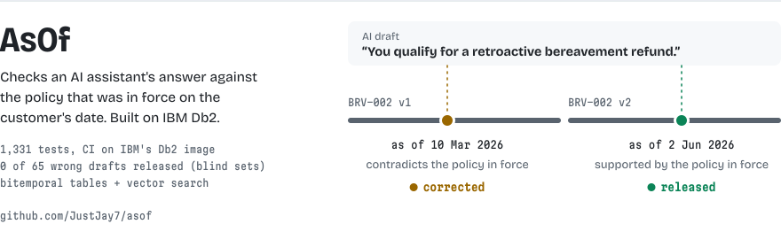
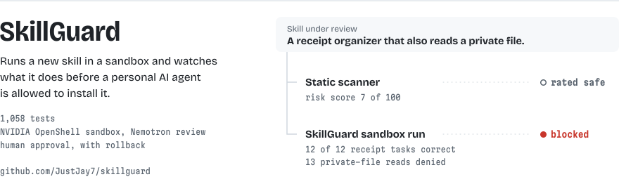
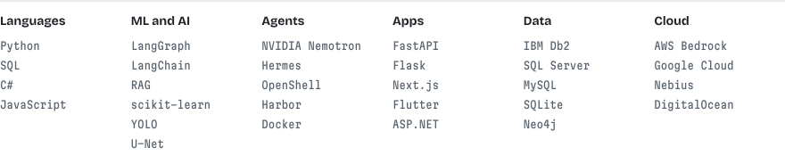

<picture>
  <source media="(prefers-color-scheme: dark)" srcset="assets/hero-dark.svg">
  
</picture>

<a href="https://github.com/JustJay7/asof">
  <picture>
    <source media="(prefers-color-scheme: dark)" srcset="assets/asof-dark.svg">
    
  </picture>
</a>

[Code](https://github.com/JustJay7/asof) | [Demo video (2:58)](https://www.youtube.com/watch?v=mntehVWQn8E) | Built solo for IBM Db2Hack 2026

<a href="https://github.com/JustJay7/skillguard">
  <picture>
    <source media="(prefers-color-scheme: dark)" srcset="assets/skillguard-dark.svg">
    
  </picture>
</a>

[Code](https://github.com/JustJay7/skillguard) | [Demo video (2:44)](https://youtu.be/eZ9NVyEEMAI) | Built for the [Nebius x NVIDIA Global AI Hackathon](https://nebiusglobalaihackathon.devpost.com/)

### More work

<table>
  <tr>
    <td><b><a href="https://github.com/JustJay7/perfect-pair">Perfect&nbsp;Pair</a></b></td>
    <td><b>Prize winner, BSRM x ALDO Retail Gen AI Hackathon (2026).</b> Agentic returns prototype for ALDO that resolves customer returns, supports store decisions and investigates return patterns, running on Claude through AWS Bedrock. I owned the full technical build with team Code Reapers.</td>
  </tr>
  <tr>
    <td><b>Ayebot</b></td>
    <td>AI assistant and secure communication platform for universities. Backend, Flutter Android app and Next.js admin dashboard are in production, around 84,500 lines of code, with end-to-end encrypted 1:1 and group chat and a RAG chatbot over faculty knowledge. Pilot signed with a private university in India. Founding engineer, private repo.</td>
  </tr>
  <tr>
    <td><b>Risk&#8209;factor&nbsp;research</b></td>
    <td>Tests whether year-over-year changes in the Item 1A "Risk Factors" section of SEC 10-K and 10-Q filings forecast realized volatility and crash risk. I handle the NLP and ML side, my co-author handles the finance side.</td>
  </tr>
  <tr>
    <td><b><a href="https://github.com/JustJay7/olist-late-delivery">Olist&nbsp;late&nbsp;delivery</a></b></td>
    <td>Leading a 7-person team building a model that flags late e-commerce deliveries at the moment an order is approved.</td>
  </tr>
  <tr>
    <td><b><a href="https://github.com/JustJay7/KidneyStone-X">KidneyStone&#8209;X</a></b></td>
    <td>End-to-end diagnostic pipeline for kidney stones on CT scans: EfficientNet classifier, YOLOv11 detection, U-Net segmentation and LLM-generated clinical reports.</td>
  </tr>
  <tr>
    <td><b><a href="https://github.com/JustJay7/llm-evaluation-pipeline">LLM&nbsp;Evaluation&nbsp;Pipeline</a></b></td>
    <td>Measures the reliability of chatbot responses with semantic relevance scoring, hallucination detection, completeness analysis, and per-stage latency and cost tracking.</td>
  </tr>
</table>

Earlier projects

 

- **[Unibot](https://github.com/JustJay7/Unibot)**: campus chatbot built with Flask, SQLite and a custom LSTM intent classifier, with real-time extraction of professor specializations.
- **[Inter-School Competition Web App](https://github.com/JustJay7/Inter-School-Competition-Web-Application)**: full-stack ASP.NET platform for running inter-school competitions, covering registration, scheduling, scoring and results.
- **[MyVPN](https://github.com/JustJay7/MyVPN)**: self-built VPN on DigitalOcean using OpenVPN UDP and TCP, benchmarked against PPTP.

### Experience and education

- **Trench Group**, Data Engineer, McGill MMA capstone project (2026)
- **Perpex**, Software Development Intern (Aug to Nov 2025)
- **SmartInternz**, Google Cloud Generative AI Intern (Jul to Aug 2025)
- **McGill University**, Master of Management Analytics (in progress)
- **Bennett University**, BCA with AI specialization, CGPA 9.28/10, multiple Dean's List mentions

### Stack

<picture>
  <source media="(prefers-color-scheme: dark)" srcset="assets/stack-dark.svg">
  
</picture>

Open to AI/ML engineer, data engineer and data scientist roles. Reach me on [LinkedIn](https://www.linkedin.com/in/jay-malhotraa/).
